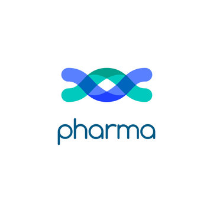

# MePharma — Enterprise Healthcare SaaS & Pharmacy Management System

<div align="center">
  
  <h3>Enterprise Multi-Tenant Pharmacy Operating System & Point of Sale</h3>
  <p>Engineered on <strong>AdonisJS v6 (TypeScript)</strong>, <strong>PostgreSQL 16</strong>, <strong>Traefik v3</strong>, and <strong>Flutter Windows Desktop</strong></p>
</div>

---

## 🌟 SaaS Architectural Hierarchy & Domain Routing

MePharma uses a domain-driven, multi-tenant architecture partitioned into two operational planes:

```
                                  ┌────────────────────────────────────────────────────────┐
                                  │                  DNS & REVERSE PROXY                   │
                                  │  Apex / Main: mepharma.net  |  Wildcard: *.mepharma.net│
                                  └──────────────────────────┬─────────────────────────────┘
                                                             │
                              ┌──────────────────────────────┴──────────────────────────────┐
                              ▼                                                             ▼
 ┌──────────────────────────────────────────────────────────┐  ┌──────────────────────────────────────────────────────────┐
 │           PROVIDER PLATFORM CONTROL PLANE                │  │              PHARMACY TENANT SUBSITE LAYER               │
 │           mepharma.net  OR  admin.mepharma.net           │  │       nakheel.mepharma.net  |  main.mepharma.net         │
 ├──────────────────────────────────────────────────────────┤  ├──────────────────────────────────────────────────────────┤
 │ • Superadmin Web Dashboard (`superadmin`)               │  │ • Branch Admin Web Dashboard (`admin`, `branch_mgr`)     │
 │ • Pharmacy Tenant Lifecycle (Create, Suspend, Upgrade)   │  │ • Inventory, Categories, Drug Formulary & Reorders       │
 │ • Cryptographic License Issuance & Seat Allocations      │  │ • Dual-Approval Procurement Pipeline (PO-YYYYMMDD-XXXX) │
 │ • Whole-System Snapshots (pg_dump) & Disaster Recovery   │  │ • Financial Analytics, COGS & Tax Valuation Reports      │
 │ • Telemetry, Audit Trails & PostgreSQL Engine Monitor    │  │ • REST API Endpoints for Counter POS Terminals           │
 └──────────────────────────────────────────────────────────┘  └──────────────────────────────────────────────────────────┘
                                                                                            │
                                                               ┌────────────────────────────┴─────────────────────────────┐
                                                               ▼                                                          ▼
                                                ┌─────────────────────────────┐            ┌─────────────────────────────┐
                                                │   DESKTOP POS TERMINAL 1    │            │   DESKTOP POS TERMINAL 2    │
                                                │  (Counter 1 / Pharmacist)   │            │  (Counter 2 / Supervisor)   │
                                                │ • Hardware UUID Fingerprint │            │ • Hardware UUID Fingerprint │
                                                │ • Offline SQLite Outbox     │            │ • Offline SQLite Outbox     │
                                                │ • Win32 Thermal Spooler     │            │ • Win32 Thermal Spooler     │
                                                └─────────────────────────────┘            └─────────────────────────────┘
```

1. **Provider Control Plane (Main System)**:
   - Accessible via the **Apex / Root Domain** (e.g. `https://mepharma.net`, `https://admin.mepharma.net`) or `http://localhost:8000` in local dev.
   - Operated exclusively by **System Admins** (SaaS Provider).
   - Manages tenant lifecycle, asymmetric cryptographic license token issuance, hardware terminal seat quotas, feature module gating, system telemetry, and whole-database backups.
2. **Pharmacy Tenant Layer (Per Pharmacy / Branch Subdomain)**:
   - Accessible via **Dynamic Tenant Subdomains** (e.g. `https://nakheel.mepharma.net`, `https://alnoor.mepharma.net`) or `http://nakheel.localhost:8000` in local dev.
   - **Pharmacy Admin Web Dashboard**: Accessible to `pharmacy_admin` and `branch_admin` for catalog management, stock replenishment approvals, purchase order editing, and financial oversight.
   - **REST API for Counter Terminals**: High-throughput AdonisJS v6 endpoints serving sales, product lookups, customer tabs, and offline synchronization batches.
   - **Desktop App (Flutter Client)**: Counter POS client operated by **Pharmacists**, **Supervisors**, and **Cashiers** with native Win32 thermal printing and offline-first SQLite synchronization.

---

## 🌐 How Domains, Subdomains & Server IP Linking Work

When you deploy MePharma on a cloud VPS or on an internal local network, requests are dynamically routed based on the HTTP `Host` header:

### 1. The DNS Wildcard Mapping
To allow any newly registered pharmacy (e.g., `nakheel`, `zahra`, `central`) to immediately receive its own subdomain without creating new DNS records every time:

| Record Type | Host / Name | Target / Destination | Purpose |
|---|---|---|---|
| **A Record** | `@` (or `mepharma.net`) | `YOUR_SERVER_PUBLIC_IP` | Points the main root domain to your server (Superadmin Plane) |
| **A Record** | `*` (Wildcard) | `YOUR_SERVER_PUBLIC_IP` | Points **every** subdomain (`nakheel.mepharma.net`, etc.) to the same server IP |

### 2. Reverse Proxy Request Routing (Traefik v3)
- When a user opens `https://mepharma.net`, DNS resolves to `YOUR_SERVER_PUBLIC_IP`. Traefik routes the request to the AdonisJS backend. The frontend detects only 2 domain parts (`mepharma.net`) and renders the **Provider Platform Control Plane (Superadmin)**.
- When a user opens `https://nakheel.mepharma.net`, DNS wildcard resolves to `YOUR_SERVER_PUBLIC_IP`. Traefik passes `Host: nakheel.mepharma.net`. The backend extracts `nakheel`, binds database queries to the isolated schema `tenant_nakheel`, and renders the **Nakheel Pharmacy Admin Dashboard**.

---

## ☁️ Online Setup (Cloud Production Deployment)

Follow this step-by-step runbook to deploy MePharma to any cloud VPS (Ubuntu 22.04 LTS recommended):

### Step 1: Server Provisioning & Firewall
Log into your cloud server via SSH and install Docker:
```bash
sudo apt-get update && sudo apt-get upgrade -y
sudo apt-get install -y docker.io docker-compose-plugin git curl ufw

# Configure Firewall (Allow HTTP, HTTPS, SSH only)
sudo ufw default deny incoming
sudo ufw default allow outgoing
sudo ufw allow 22/tcp    # SSH
sudo ufw allow 80/tcp    # HTTP (Traefik Ingress)
sudo ufw allow 443/tcp   # HTTPS (Traefik TLS Ingress)
sudo ufw enable
```

### Step 2: Configure DNS Records
Go to your domain registrar or DNS provider (e.g. Cloudflare, Namecheap, GoDaddy, AWS Route53):
1. Add an **A Record**: Name: `@`, IPv4 address: `YOUR_SERVER_PUBLIC_IP`, TTL: Auto / 300.
2. Add a **Wildcard A Record**: Name: `*`, IPv4 address: `YOUR_SERVER_PUBLIC_IP`, TTL: Auto / 300.

> [!TIP]
> **Using Cloudflare (Recommended for Zero-Config Wildcard SSL):**
> 1. Set Proxy Status to **Proxied (Orange Cloud ☁️)** on both `@` and `*` records.
> 2. In Cloudflare Dashboard -> **SSL/TLS** -> Set encryption mode to **Full** (or **Full Strict**).
> 3. Cloudflare automatically issues and manages free Universal Wildcard SSL certificates for `yourdomain.com` and `*.yourdomain.com`.

### Step 3: Clone Repository & Configure Environment
```bash
# Clone to production directory
sudo mkdir -p /opt/mepharma
sudo git clone <your-repository-url> /opt/mepharma
cd /opt/mepharma

# Create production environment file from template
cp .env.production.example .env

# Generate high-entropy production secrets
PROD_APP_KEY=$(node -e "console.log(require('crypto').randomBytes(16).toString('hex'))")
PROD_JWT_SECRET=$(node -e "console.log(require('crypto').randomBytes(32).toString('hex'))")
PROD_LICENSE_SECRET=$(node -e "console.log(require('crypto').randomBytes(32).toString('hex'))")
PROD_DB_PASS=$(node -e "console.log(require('crypto').randomBytes(24).toString('hex'))")

# Inject secrets into .env
sed -i "s/replace_with_a_secure_random_32_char_app_key_for_production/$PROD_APP_KEY/" .env
sed -i "s/replace_with_a_high_entropy_secret_for_jwt_session_signing_2026/$PROD_JWT_SECRET/" .env
sed -i "s/replace_with_a_high_entropy_secret_for_license_crypto_tokens_2026/$PROD_LICENSE_SECRET/" .env
sed -i "s/replace_with_a_secure_postgres_password_here/$PROD_DB_PASS/" .env
```

### Step 4: Launch the Production Stack
```bash
docker compose up -d --build
```
On boot, `backend/docker-entrypoint.sh` automatically:
1. Waits for PostgreSQL 16 to report healthy.
2. Applies all database migrations (`node ace migration:run --force`).
3. Seeds the provider superadmin account, the default `main` enterprise pharmacy, and the master drug formulary.
4. Boots the AdonisJS v6 server engine.

### Step 5: Verification & Health Check
```bash
# Check container status
docker compose ps

# Test internal engine health
curl -I http://127.0.0.1:3334/status
```

### Step 6: Log Into the Superadmin Control Plane
1. Open your browser and navigate to: `https://mepharma.net` (or `https://admin.mepharma.net`).
2. Sign in with the master system credentials:
   - **Username**: `superadmin`
   - **Password**: `superadmin123`
3. Click **"+ Register New Pharmacy"** to register a new tenant (e.g. Code: `nakheel`, Name: `Al-Nakheel Modern Pharmacy`).
4. Set license parameters (e.g. Plan: Enterprise, Terminals: 3).
5. The system instantly provisions the dedicated PostgreSQL schema `tenant_nakheel`, seeds default accounts, and issues a cryptographic license key.
6. The new pharmacy is immediately live at: `https://nakheel.mepharma.net`!

---

## 💻 Offline & Local Environment Setup (Development / LAN)

You can run and test the complete multi-tenant platform on a local Windows machine or on an offline LAN without buying a domain name or needing an active internet connection.

### How Localhost Subdomains Work
Modern web browsers (Google Chrome, Microsoft Edge, Brave, Firefox) automatically resolve `*.localhost` (such as `nakheel.localhost` and `main.localhost`) to loopback IP `127.0.0.1`.

### Step 1: Start the Local Backend
Ensure Docker Desktop is running on your Windows machine, then run:
```powershell
# From project root (d:\mepharma)
docker compose up -d --build
```
- **Provider Superadmin Plane**: `http://localhost:8000/`
- **Main Pharmacy Admin Plane**: `http://main.localhost:8000/`
- **New Pharmacy Admin Plane**: `http://nakheel.localhost:8000/`

> [!NOTE]
> **Windows Local DNS Resolution:**
> Web browsers natively map `*.localhost` to `127.0.0.1`. However, if you are testing across multiple PCs on the same Wi-Fi or LAN, edit your Windows hosts file (`C:\Windows\System32\drivers\etc\hosts`) as Administrator:
> ```text
> 127.0.0.1    mepharma.local
> 127.0.0.1    main.mepharma.local
> 127.0.0.1    nakheel.mepharma.local
> ```

### Step 2: Configure & Run the Windows Desktop POS App
The desktop application is built with Flutter and communicates with the backend via REST API while maintaining an offline-first Drift SQLite database.

```powershell
cd d:\mepharma\frontend
flutter pub get
flutter run -d windows
```

### Step 3: First-Time POS Activation
1. When the desktop app opens, navigate to **Settings -> Activation & Environment**.
2. Set the Server Address:
   - **Online Cloud**: `https://nakheel.mepharma.net/api`
   - **Local Docker**: `http://localhost:8000/api`
3. Paste the cryptographic license key generated from the Provider Control Plane.
4. Click **"Activate License"**:
   - The desktop app registers its native Windows hardware UUID (`TERM-WIN-...`).
   - The server validates the hardware seat quota (e.g., Seat 1 of 3).
   - Pharmacy store settings (currency, tax rate, footer, branch name) are pulled and saved locally.

### Step 4: Testing Offline Resilience (Unplugged POS)
1. Turn off your Wi-Fi or stop the backend container (`docker compose stop backend`).
2. Notice the POS status indicator switches to **"Offline Mode" (أوفلاين)**.
3. Conduct counter sales, scan barcodes, and complete cash payments:
   - The app writes sales to the local SQLite database.
   - Local inventory is decremented immediately.
   - Sales are enqueued in the SQLite sync outbox with unique idempotency keys.
   - Receipts print normally to the USB thermal printer via the direct Win32 spooler.
4. Reconnect network or restart the backend container (`docker compose start backend`):
   - The background sync engine automatically flushes the outbox queue.
   - Transactions are committed to the cloud backend with zero duplicate sales.

---

## 🔑 Default System Credentials

| Operational Plane | User Role | Access Point | Username | Password |
|---|---|---|---|---|
| **Platform HQ** | **System Superadmin** | Root Domain (`/provider`) | `superadmin` | `superadmin123` |
| **Pharmacy Branch** | **Pharmacy Admin** | Tenant Subdomain (`/dashboard`) | `admin` | `admin123` |
| **Pharmacy Branch** | **Branch Manager** | Desktop App & Web Dashboard | `branch_mgr` | `branch123` |
| **Counter Terminal** | **Supervisor** | **Desktop App (Flutter) ONLY** | `supervisor` | `supervisor123` |
| **Counter Terminal** | **Pharmacist / Cashier** | **Desktop App (Flutter) ONLY** | `staff` or `pharmacist` | `staff123` |

> [!WARNING]
> Attempting to log into the Web Dashboard using `pharmacist` or `supervisor` credentials will be rejected with `HTTP 403 Forbidden` (`DESKTOP_CLIENT_REQUIRED`), instructing the staff member to use the desktop POS terminal.

---

## 🖨️ Thermal Receipt Printing Configuration

MePharma includes a custom Win32 native spooler engine that directly communicates with Windows print spoolers (`winspool.drv`):

1. **Auto-Discovery**: Open Desktop POS -> **Settings -> Printer Configuration** and click **"Scan USB/Windows Printers"**.
2. **Select Printer**: Choose your installed thermal printer (e.g. `POS-80`, `XP-80C`, `Epson TM-T20`).
3. **Paper Format**: Choose `80mm (Standard POS)` or `58mm (Compact Roll)`.
4. **Encoding Protection**: Arabic labels and Indo-Arabic numerals are transliterated on the fly to prevent spooler encoding crashes.

---

## 📦 Compiling the Windows Installer (Inno Setup)

To build a standalone `.exe` installer for client pharmacy counter machines:

```powershell
# From project root
powershell -ExecutionPolicy Bypass -File setup\build_installer.ps1
```
The compiled self-contained installer will be generated at:
```text
setup\Output\MePharma_Setup_v1.0.0.exe
```
This installer packages the Flutter desktop executable, native Win32 DLLs, SQLite runtime, assets, and font files for offline installation on Windows 10/11 (x64).

---

## 🛡️ Disaster Recovery & Whole-System Backups

Automated database backups can be triggered via the Provider Control Plane or CLI:
- **Snapshot Location**: Persisted on host in `./backups/`
- **CLI Manual Backup**:
  ```bash
  docker exec -t mepharma_backend node ace db:backup
  ```
- **CLI Manual Restore**:
  ```bash
  docker exec -i mepharma_backend psql -h db -U mepharma_user -d mepharma < backups/mepharma_full_backup_YYYY-MM-DD.sql
  ```
