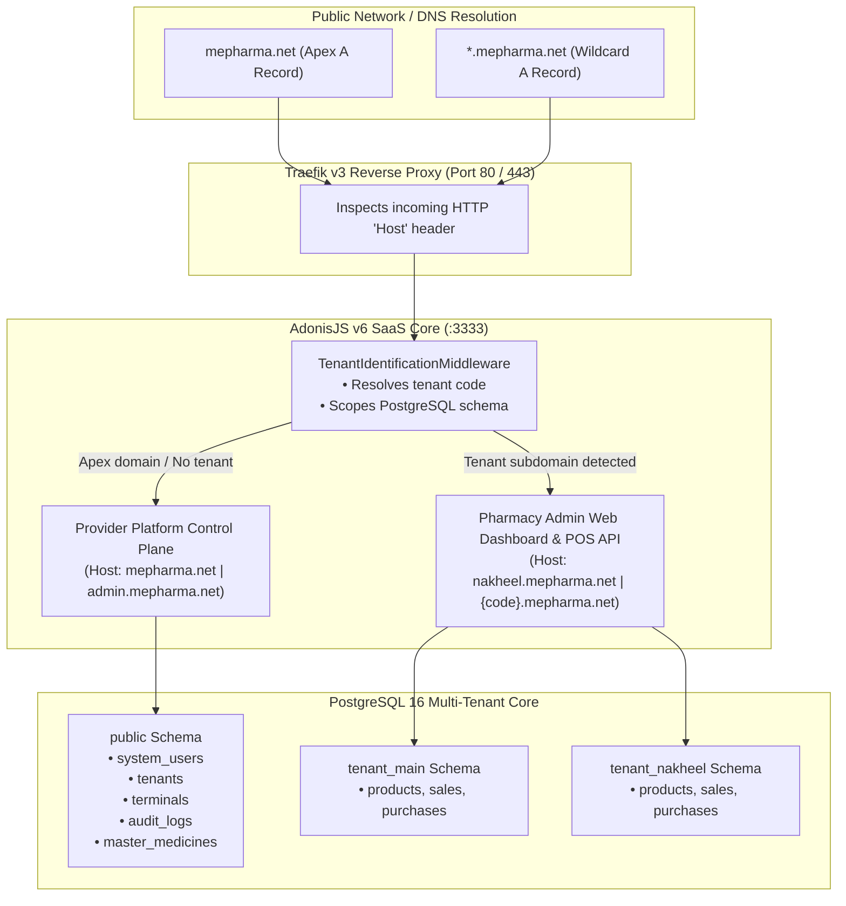

# 🌐 MePharma — Production & Local Deployment Manual

This guide provides end-to-end instructions for deploying the **MePharma Enterprise Multi-Tenant Platform** across both **Public Cloud Infrastructure (Online Production)** and **Local / Offline LAN Environments (Development & Private Networks)**.

---

## 📑 Table of Contents

1. [Architectural Overview & Domain-Driven Routing](#1-architectural-overview--domain-driven-routing)
2. [DNS Wildcard Mapping & Server IP Linking](#2-dns-wildcard-mapping--server-ip-linking)
3. [Online Cloud Deployment Runbook (Production VPS)](#3-online-cloud-deployment-runbook-production-vps)
4. [Offline & Local Environment Setup (Development / LAN)](#4-offline--local-environment-setup-development--lan)
5. [Desktop POS Terminal Setup & Hardware Seats](#5-desktop-pos-terminal-setup--hardware-seats)
6. [Native Win32 Thermal Printing Configuration](#6-native-win32-thermal-printing-configuration)
7. [Disaster Recovery & Whole-System Backups](#7-disaster-recovery--whole-system-backups)
8. [System Credentials Cheat Sheet](#8-system-credentials-cheat-sheet)

---

## 1. Architectural Overview & Domain-Driven Routing

MePharma uses a domain-driven, multi-tenant architecture partitioned into two operational planes:



### Operational Planes Explained

| Plane | Access Domain | Primary Role | Core Functions |
|---|---|---|---|
| **Provider Platform Control Plane** | `https://mepharma.net`<br>or `https://admin.mepharma.net` | SaaS Provider System Admins (`superadmin`) | • Register and suspend pharmacy tenants<br>• Issue asymmetric cryptographic licenses<br>• Manage terminal hardware seats & replacements<br>• Global drug formulary & master catalog<br>• Whole-system snapshots (`pg_dump`) & telemetry |
| **Pharmacy Tenant Subsite Layer** | `https://{code}.mepharma.net`<br>(e.g. `nakheel.mepharma.net`) | Pharmacy Admin (`admin`) & Branch Managers | • Inventory management & dynamic pricing<br>• Dual-approval purchase orders (`PO-YYYYMMDD-XXXX`)<br>• Real-time sales transactions & cash registers<br>• Financial reports (COGS, valuation, monthly trends)<br>• Counter POS REST APIs |
| **Counter POS Terminals** | Native Flutter Desktop App | Pharmacists & Supervisors | • Rapid barcode scanning & keyboard shortcuts<br>• Native Win32 thermal printing (58mm / 80mm)<br>• Offline-first SQLite caching & auto-sync outbox |

---

## 2. DNS Wildcard Mapping & Server IP Linking

To allow any newly registered pharmacy (e.g. `nakheel`, `alnoor`, `central`) to immediately receive its own subdomain without manually adding DNS records every time, configure **Wildcard DNS**:

### Required DNS Records

| Record Type | Host / Name | Target / Destination | TTL | Purpose |
|---|---|---|---|---|
| **A Record** | `@` (or `mepharma.net`) | `YOUR_SERVER_PUBLIC_IP` | 300 / Auto | Routes the main root domain to your server (Superadmin Plane) |
| **A Record** | `*` (Wildcard) | `YOUR_SERVER_PUBLIC_IP` | 300 / Auto | Routes **every** subdomain (`nakheel.mepharma.net`, etc.) to the same server IP |

### Cloudflare Wildcard SSL (Recommended)
If you manage your domain via Cloudflare:
1. Set Proxy Status to **Proxied (Orange Cloud ☁️)** on both `@` and `*` records.
2. In Cloudflare Dashboard -> **SSL/TLS** -> Set encryption mode to **Full** (or **Full Strict**).
3. Cloudflare automatically issues and manages free Universal Wildcard SSL certificates for `yourdomain.com` and `*.yourdomain.com`, providing instant HTTPS with DDoS protection.

---

## 3. Online Cloud Deployment Runbook (Production VPS)

Follow this step-by-step runbook to deploy MePharma on a clean Linux server (Ubuntu 22.04 LTS or Debian 12 recommended).

### Step 1: Server Preparation & Firewall
SSH into your cloud server and install Docker and essential tools:
```bash
sudo apt-get update && sudo apt-get upgrade -y
sudo apt-get install -y docker.io docker-compose-plugin git curl ufw

# Configure Firewall (Allow HTTP, HTTPS, SSH only)
sudo ufw default deny incoming
sudo ufw default allow outgoing
sudo ufw allow 22/tcp    # SSH
sudo ufw allow 80/tcp    # HTTP (Traefik Ingress)
sudo ufw allow 443/tcp   # HTTPS (Traefik TLS Ingress)
sudo ufw enable
```

### Step 2: Clone Repository & Set Permissions
```bash
sudo mkdir -p /opt/mepharma
sudo git clone <your-repository-url> /opt/mepharma
cd /opt/mepharma
```

### Step 3: Configure Environment Secrets
Copy the production environment template and generate cryptographic secrets:
```bash
# Copy template
cp .env.production.example .env

# Generate high-entropy 32-character secrets using Node.js
PROD_APP_KEY=$(node -e "console.log(require('crypto').randomBytes(16).toString('hex'))")
PROD_JWT_SECRET=$(node -e "console.log(require('crypto').randomBytes(32).toString('hex'))")
PROD_LICENSE_SECRET=$(node -e "console.log(require('crypto').randomBytes(32).toString('hex'))")
PROD_DB_PASS=$(node -e "console.log(require('crypto').randomBytes(24).toString('hex'))")

# Inject secrets into .env
sed -i "s/replace_with_a_secure_random_32_char_app_key_for_production/$PROD_APP_KEY/" .env
sed -i "s/replace_with_a_high_entropy_secret_for_jwt_session_signing_2026/$PROD_JWT_SECRET/" .env
sed -i "s/replace_with_a_high_entropy_secret_for_license_crypto_tokens_2026/$PROD_LICENSE_SECRET/" .env
sed -i "s/replace_with_a_secure_postgres_password_here/$PROD_DB_PASS/" .env
```

### Step 4: Launch Container Stack
Start the edge proxy, database, and backend engine:
```bash
docker compose up -d --build
```

The container entrypoint (`backend/docker-entrypoint.sh`) automatically:
1. Waits for PostgreSQL 16 to report healthy.
2. Applies all database migrations (`node ace migration:run --force`).
3. Seeds the provider superadmin account, the default `main` pharmacy, and the master drug formulary.
4. Boots the AdonisJS v6 server engine on internal port 3333.

### Step 5: Verify Deployment Health
```bash
# Verify container statuses
docker compose ps

# Check internal backend health check
curl -I http://127.0.0.1:3334/status

# View application logs
docker compose logs -f backend
```

### Step 6: Initial Superadmin Onboarding
1. Open your browser and navigate to: `https://mepharma.net` (or your server's IP address).
2. Sign in with the system credentials:
   - **Username**: `superadmin`
   - **Password**: `superadmin123`
3. Click **"+ Register New Pharmacy"**:
   - **Pharmacy Code**: `nakheel`
   - **Pharmacy Name**: `Al-Nakheel Modern Pharmacy`
   - **Subscription Plan**: `Enterprise`
   - **Terminal Seats Quota**: `5`
4. The system provisions the database schema `tenant_nakheel`, seeds the admin, and issues a cryptographic license key.
5. The new branch portal is live at: `https://nakheel.mepharma.net`.

---

## 4. Offline & Local Environment Setup (Development / LAN)

You can run and test the complete multi-tenant system locally on a single PC or across a local pharmacy network (LAN) without buying a domain name or having an active internet connection.

### How Local Subdomains Work
Modern web browsers (Google Chrome, Microsoft Edge, Brave, Firefox) automatically resolve `*.localhost` (such as `nakheel.localhost` and `main.localhost`) to loopback IP `127.0.0.1`.

### Step 1: Start the Local Stack
Ensure Docker Desktop is running, then execute from the repository root:
```powershell
docker compose up -d --build
```
- **Superadmin Control Plane**: `http://localhost:8000/`
- **Main Pharmacy Portal**: `http://main.localhost:8000/`
- **Nakheel Pharmacy Portal**: `http://nakheel.localhost:8000/`

### Step 2: Multi-PC Local Area Network (LAN) Configuration
To access the server PC (e.g. `192.168.1.100`) from other counter terminals on the same Wi-Fi:
Edit the `hosts` file on client PCs (`C:\Windows\System32\drivers\etc\hosts` as Administrator):
```text
192.168.1.100    mepharma.local
192.168.1.100    main.mepharma.local
192.168.1.100    nakheel.mepharma.local
```

### Step 3: Run the Flutter Windows Desktop App
```powershell
cd frontend
flutter pub get
flutter run -d windows
```

### Step 4: Testing Offline Resilience (Unplugged Counter)
1. Turn off your Wi-Fi or stop the backend container (`docker compose stop backend`).
2. Notice the POS status indicator switches to **"Offline Mode" (أوفلاين)**.
3. Conduct counter sales, scan barcodes, and complete cash payments:
   - The app writes sales to the local SQLite database.
   - Local inventory is decremented immediately.
   - Sales are enqueued in the SQLite sync outbox with unique idempotency keys.
   - Receipts print normally to the USB thermal printer via the direct Win32 spooler.
4. Reconnect network or restart the backend container (`docker compose start backend`):
   - The background sync engine automatically flushes the outbox queue.
   - Transactions are committed to the cloud backend with zero duplicate sales.

---

## 5. Desktop POS Terminal Setup & Hardware Seats

Each physical counter terminal is securely authenticated using hardware fingerprinting:

### 1. Hardware Fingerprinting (`DeviceIdentifierService`)
The desktop client generates a persistent machine identifier from the Windows machine GUID:
```text
TERM-WIN-B7F2-491A-8E03
```
This identifier is transmitted with every REST request via the `X-Terminal-Hardware-ID` header.

### 2. First-Time POS Activation
1. Launch the Desktop App and navigate to **Settings -> Activation & Environment**.
2. Configure Server URL:
   - **Online Cloud**: `https://nakheel.mepharma.net/api`
   - **Local Docker**: `http://localhost:8000/api`
3. Enter the Cryptographic License Key generated from the Provider Control Plane.
4. Click **"Activate License"**:
   - The server verifies license signature and validity.
   - The server validates seat quota (e.g., Seat 2 of 5).
   - Store settings (currency, tax rate, footer) are synchronized and cached locally.

### 3. Remote Seat Replacement & Unlinking
If a pharmacy reaches its licensed seat limit and needs to replace a damaged terminal:
1. Log into the Superadmin Control Plane -> **Pharmacies & Tenants**.
2. Click on the pharmacy -> Open the **Terminal Seats** manager modal.
3. Click **"Unlink Terminal"** next to the retired device.
4. The vacant seat is immediately freed up for the new machine.

---

## 6. Native Win32 Thermal Printing Configuration

MePharma bypasses slow external print drivers and communicates directly with the Windows Print Spooler (`winspool.drv`):

1. **Auto-Discovery**:
   - Open Desktop POS -> **Settings -> Printer Configuration**.
   - Click **"Scan USB/Windows Printers"** (invokes native `EnumPrinters`).
2. **Select Printer**:
   - Select your detected thermal printer (e.g. `POS-80`, `XP-80C`, `Epson TM-T20`).
3. **Paper Formats Supported**:
   - `80mm (Standard POS)`: 48 columns.
   - `58mm (Compact Roll)`: 32 columns.
4. **Encoding Protection**:
   - Arabic text, currency symbols, and numerals are automatically transliterated on the fly to prevent ESC/POS encoding crashes.

---

## 7. Disaster Recovery & Whole-System Backups

### Automated Snapshots
The system persists database snapshots inside the `./backups/` directory on the host server.

### Manual Backup (CLI)
To trigger an immediate complete database snapshot:
```bash
docker exec -t mepharma_backend node ace db:backup
```

### Manual Restore (CLI)
To restore a snapshot into PostgreSQL:
```bash
docker exec -i mepharma_backend psql -h db -U mepharma_user -d mepharma < backups/mepharma_full_backup_YYYY-MM-DD.sql
```

---

## 8. System Credentials Cheat Sheet

| Operational Plane | User Role | Access Point | Default Username | Default Password |
|---|---|---|---|---|
| **Platform HQ** | **System Superadmin** | Root Domain (`/provider`) | `superadmin` | `superadmin123` |
| **Pharmacy Branch** | **Pharmacy Admin** | Tenant Subdomain (`/dashboard`) | `admin` | `admin123` |
| **Pharmacy Branch** | **Branch Manager** | Desktop App & Web Dashboard | `branch_mgr` | `branch123` |
| **Counter Terminal** | **Supervisor** | **Desktop App (Flutter) ONLY** | `supervisor` | `supervisor123` |
| **Counter Terminal** | **Pharmacist / Cashier** | **Desktop App (Flutter) ONLY** | `staff` or `pharmacist` | `staff123` |

> [!WARNING]
> Attempting to log into the Web Dashboard using `pharmacist` or `supervisor` credentials will be rejected with `HTTP 403 Forbidden` (`DESKTOP_CLIENT_REQUIRED`), instructing the staff member to use the desktop POS terminal.
